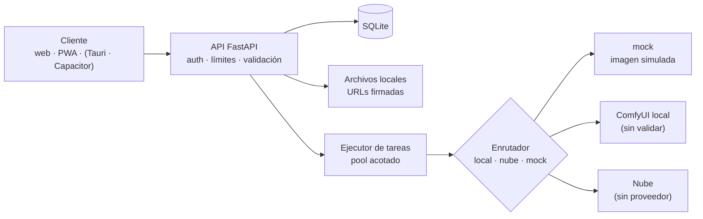

# Arquitectura — AI Creator Studio (prototipo v0.1)

**Estado:** prototipo en construcción. Línea base: *Plan maestro v1.0* (27/10/2026).
El *Informe técnico* (clon de IA HUB + IA Influencer con chat y videollamada) marca la dirección
del producto completo; aquí solo se construye lo que el Plan maestro fija como primer prototipo.
Lo que no está validado se dice como tal.

## Qué se construye ahora y qué se difiere

| Tema | Plan maestro (prototipo) | Informe v1 (producto completo) | Decisión actual |
|---|---|---|---|
| Interfaz | React + TypeScript, PWA | Next.js + React Native | React + TS con Vite (PWA); Tauri y Capacitor después, sin reescribir |
| API | FastAPI | FastAPI | FastAPI |
| Datos | SQLite | PostgreSQL | SQLite; migrar al pasar a multiusuario |
| Archivos | Disco local | S3 / R2 | Disco local con URLs firmadas de 1 h |
| Tareas | Asíncronas | Redis + Celery | Pool en proceso con límite de concurrencia |
| Cobro y créditos | Fuera de alcance | Stripe + libro de créditos | Diferido |
| Consistencia | Referencias + evaluación manual | LoRA entrenado | Referencias + lote de 4 pruebas; LoRA es una fase posterior |
| Video, baile, lipsync | Fuera de alcance | Fase 2 | Diferido |
| Chat y videollamada | No contemplados | Fases 3–4 | Diferido |
| FreeLLMAPI / OpenJarvis | Opcionales, fase 9 | Núcleo del LLM | Diferido; carpetas reservadas |
| Contenido +18 | Sin definir | Pipeline sin censura | No se implementa; solo un filtro mínimo contra contenido sexual con menores |

## Capas

## Reglas que no se rompen
1. El cliente solo habla con la API. Los secretos viven en el servidor.
2. Ninguna generación es síncrona: se encola y se consulta su estado.
3. «Automático» nunca usa la nube. La nube exige configuración y confirmación explícita del usuario.
4. Las referencias del personaje solo salen a un tercero con confirmación.
5. Los motores son adaptadores: cambiar de proveedor no toca la lógica central.
6. Cada imagen guarda prompt, semilla, modelo, motor y versión del flujo.

## Contrato y seguridad
- Contrato de la API: [api-contracts.md](api-contracts.md) (fuente de verdad entre backend y frontend).
- Controles y pendientes de seguridad: [security.md](security.md).

## Decisiones pendientes (del Plan maestro §15)
- **Equipo:** RAM, GPU y disco del PC determinan si la generación local es viable. Sin ese dato no se descarga ningún modelo.
- **Modelo de imagen:** comparar con hardware real (calidad, consistencia, licencia).
- **Proveedor de nube:** revisar cuota vigente, privacidad, retención y condiciones antes de implementar su adaptador.
- **Autenticación:** el prototipo usa una clave de API; el acceso remoto exige HTTPS o VPN/túnel.
- **Publicación iOS:** empezar con PWA; la app nativa requiere macOS/Xcode y cuenta de desarrollador.

## Correcciones al Informe v1 detectadas al revisarlo
- Su script SQL crea un índice sobre `jobs(estado)`, columna que la tabla `jobs` no tiene. No se copió.
- Los identificadores de modelos de fal.ai (`fal-ai/wan-i2v`, `flux-lora`) no estaban verificados. No se usan.
- FreeLLMAPI declara uso personal de un solo usuario y sus cifras difieren entre README (34 proveedores, 635 endpoints), sitio (65, 985) y catálogo (38, 395). No se usa como base del producto ni como dato.
